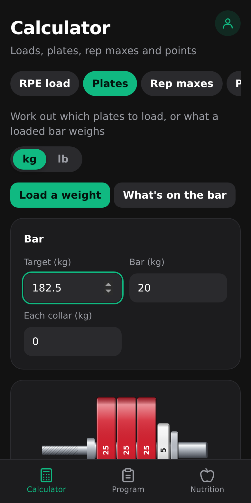
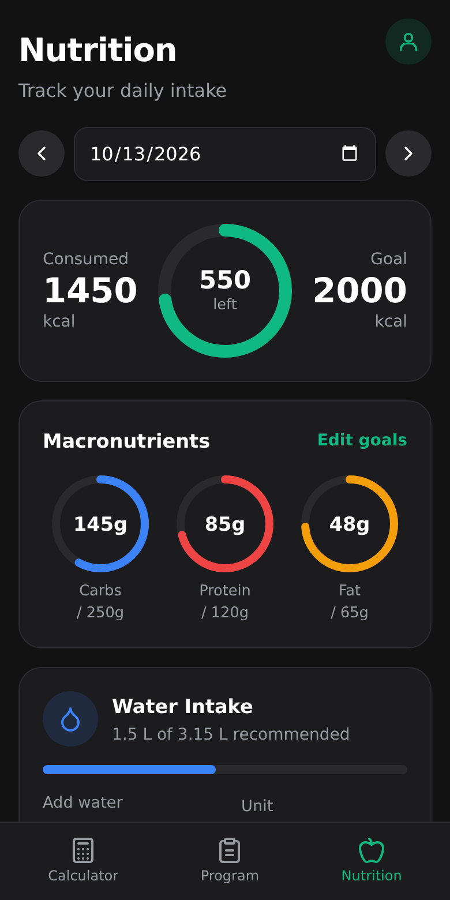
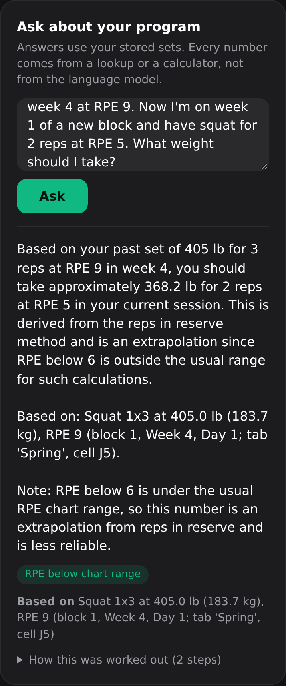

# KiloPlan

A powerlifting app with three parts: gym calculators, a food diary, and an assistant that
answers questions about your own training program.

<p>
  
  
  
</p>

## What it does

**Calculators**
- RPE load: the weight to use for a set, from a past set and its RPE
- Plates: which plates to load from your own inventory, or what a loaded bar weighs
- Rep maxes: 1 to 10RM estimates and an RPE chart from one set
- Points: DOTS, IPF GL, Wilks and Wilks 2020, plus the total needed for a target score
- Attempts: opener, second and third for a meet

**Food diary**
- 7,793 generic foods from USDA FoodData Central, logged by grams or household portion
- Daily calorie and macro goals, saved meals, custom foods, quick add and water tracking

**Program assistant**
- Upload a coach's Excel program. It is parsed into structured rows: block, week, day,
  lift, sets, reps, load in kg and RPE.
- Ask questions in plain language, such as "I took 405 for 3 on squat in week 4 at RPE 9.
  What should I take for 2 at RPE 5?"
- A local language model chooses which tools to call. Every number in an answer comes
  from a lookup or a calculator, never from the model, and the answer names the logged
  set it used.

The third screenshot above is a real answer from the local model, asked about an
example program: it found the logged set, calculated the load, and flagged that the
target RPE is below the usual chart range.

**Accounts**
- Sign up and log in to keep your own program, diary and settings. The app also works
  without an account, as a guest.

## How it is built

```
Excel program ─┐
               ├─> FastAPI + SQLite ──> Parquet files ─┬─> dbt on DuckDB ──> summary tables
USDA foods ────┘          │                            │                          │
                          │                            └─> S3 ─> Snowflake ─> dbt (same models)
                          └──────── assistant tools (lookups, calculators) <──────┘
```

| Part | Technology |
|---|---|
| API | Python 3.12, FastAPI, SQLAlchemy, SQLite |
| Frontend | React, TypeScript, Vite |
| Spreadsheet ingestion | openpyxl, with data quality checks reported per cell |
| Pipeline | pandas and pyarrow to Parquet, uploaded to S3 and loaded into Snowflake; dbt (8 models, 44 data tests) runs on DuckDB and on Snowflake |
| Assistant | Ollama running a local model with tool calling, behind a provider interface |
| Accounts | Argon2 password hashes, hashed session tokens in an HttpOnly cookie |
| Quality | pytest (322 tests), ruff, GitHub Actions on every pull request |

A few design choices worth knowing:

- **The model never does arithmetic.** Answers are checked in code: a number that did not
  come from a tool is sent back, and the answer is replaced from the tool results if it
  is still wrong.
- **SQL and Python agree.** The e1RM and volume formulas exist in both; the tests build
  the dbt project and compare the two row by row.
- **Weights are stored in kg** and converted only for display.

## Setup

You need Python 3.12 with [uv](https://docs.astral.sh/uv/), Node.js, and optionally
[Ollama](https://ollama.com) for the assistant.

```bash
uv sync                                   # Python dependencies
(cd frontend && npm install)              # frontend dependencies
uv run python -m kiloplan.ingestion.usda  # load the USDA foods (once, about 6 MB)
ollama pull qwen2.5:7b                    # the assistant's model (once, about 4.7 GB)
```

## Running it

```bash
./scripts/dev.sh
```

This starts the API on port 8000, the frontend on port 5173 and, if it is installed,
Ollama. Open http://localhost:5173. Press Ctrl+C to stop everything.

To rebuild the summary tables the assistant reads for volume and food questions:

```bash
uv run python -m kiloplan.pipeline
```

### S3 and Snowflake (optional)

The same pipeline can upload its Parquet files to S3 and build the dbt models in Snowflake.
Put the settings in `.env` (gitignored; never commit keys):

```
AWS_ACCESS_KEY_ID=...        AWS_SECRET_ACCESS_KEY=...      AWS_REGION=...
KILOPLAN_S3_BUCKET=...       # setting this alone turns on the S3 upload
SNOWFLAKE_ACCOUNT=...        SNOWFLAKE_USER=KILOPLAN_PIPELINE
SNOWFLAKE_PRIVATE_KEY_PATH=~/.snowflake/rsa_key.p8
```

In AWS, give the pipeline its own IAM user with only the policy in `docs/iam-policy.json`
(list, read, write and delete in one bucket). Run `snowflake/setup.sql` once in Snowflake
(with your public key in it) to create the warehouse, database, a role limited to what the
pipeline needs, and the user, then:

```bash
uv sync --group snowflake
uv run python -m kiloplan.pipeline --target snowflake   # run from the repo root
```

The Snowflake run loads the files from S3 into `RAW` tables and builds the models in
`ANALYTICS`. The default run, tests and CI use DuckDB and need no cloud account.

## Development

```bash
uv run pytest            # tests
uv run ruff check .      # lint
uv run ruff format .     # format
cd frontend && npm run lint && npm run build
```

## Status

This is a personal project that runs locally. The pipeline also runs on AWS S3 and Snowflake
(see below); the app itself is not deployed. Not built yet: branded foods and password reset.

## License

MIT
